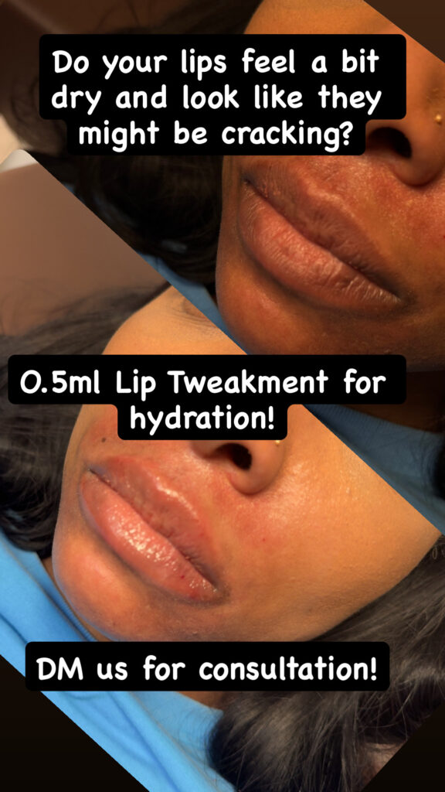

# What Is the Difference Between a Lip Flip and Lip Filler?

A lip flip changes the position of the upper lip by relaxing nearby muscle. Lip filler adds volume and can change the lips' shape or definition, so the treatments address different reasons for wanting fuller-looking lips.

At Estar MedSpa & Innovative Health Center in Olney, MD, a [Botox lip flip](https://estarmedspa.com/services/botox-lip-flip-olney-maryland/) is an option for showing more of the upper lip without adding filler. The choice starts with what is creating the appearance you want to change: movement, volume, or both.

## When Does a Lip Flip Fit the Concern?

A [lip flip](https://my.clevelandclinic.org/health/treatments/22362-lip-flip) uses botulinum toxin to relax muscle around the upper lip. That can allow the lip to turn outward slightly, making more of it visible.

If your upper lip becomes less visible when you smile, the change in position may address part of that concern. The procedure does not add material to the lips or supply volume to a thin lower lip.

That limit matters when comparing photographs of lips at rest with lips in a smile. A treatment aimed at movement is answering a different question from one intended to make both lips fuller while the face is relaxed.

A lip flip is often discussed as a subtle option, but subtlety alone does not establish suitability. A small change in upper-lip position may be useful for one concern and leave another unchanged.

## What Can Lip Filler Do Instead?

[Lip filler](https://my.clevelandclinic.org/health/treatments/22133-lip-fillers) adds material to the lips, commonly hyaluronic acid, to increase fullness and influence shape. Placement and amount affect the intended change.

Filler can be considered for more volume, a clearer lip outline, or better balance between the lips. It does not have to mean enlarging both lips by the same amount.

Estar's [dermal filler options](https://estarmedspa.com/services/dermal-fillers-olney-maryland/) include Juvéderm Ultra XC for lip enhancement. That lip-specific option belongs to a broader range of fillers used for different facial concerns.

A product intended for another area of the face is not automatically the product for your lips. The clinician selects the formulation and placement for the proposed treatment rather than treating the whole filler range as interchangeable.

For someone wanting fuller lips at rest, adding volume may address the concern more directly than relaxing muscle. For someone mainly concerned about upper-lip visibility in motion, adding volume and changing position are distinct choices to assess.

## Does Filler Have to Produce a Dramatic Result?

Estar's [lip-filler gallery](https://estarmedspa.com/before-and-afters/) includes this example of a 0.5 mL treatment. The change in fullness is visible without a large increase in overall size.

*Caption: A modest increase in fullness with 0.5 mL of lip filler at Estar. Individual results vary.*

This example helps separate the type of treatment from the degree of change. A preference for modest enhancement does not automatically rule out filler or make a lip flip the better choice.

The same amount will not produce the same appearance on every face. Your existing lip shape and the proposed placement still determine what a suitable treatment could achieve.

Neither option is inherently the more natural-looking one for everyone. The useful distinction is whether the planned change fits your concern and preserves the features you want to keep.

## How Do the Result Timelines Compare?

A lip flip develops gradually as the muscle-relaxing effect takes hold. Estar advises allowing 10 to 14 days for the full result.

Filler can increase fullness immediately, but swelling can temporarily distort its appearance. Allowing roughly two weeks before judging the result gives recovery time to settle; individual healing may take longer.

For event planning, the differences are:

- **Lip flip:** The effect needs time to develop, so treatment just before an event may be too late.
- **Lip filler:** Early fullness is not the settled result, and visible swelling or bruising may affect photographs or social plans.

Estar offers numbing cream or a cold compress before lip-flip injections when needed for comfort. A pinch or pressure can still be noticeable, and the practice generally allows up to an hour for the appointment, including any numbing time.

The lip-flip visit also includes about 15 minutes of observation afterward. That monitoring concerns the immediate response to treatment rather than judging the cosmetic effect.

Filler treatment commonly uses a topical anesthetic or another numbing method before injections at selected sites. The larger practical difference for your calendar is the recovery afterward, not an assumption that one appointment will be painless or leave no visible marks.

For its lip-flip aftercare, Estar advises avoiding lip products for three to four days and avoiding pressure on the lips. A treatment that does not add volume can still require changes to your usual routine while the injection sites recover.

## How Long Do the Results Last?

Estar gives a three- to four-month estimate for a lip flip. As the muscle-relaxing effect wears off, the change in upper-lip position fades.

Hyaluronic acid lip filler generally lasts longer. Cleveland Clinic gives a broad 12- to 18-month range, while the formulation, amount, and individual response affect the actual duration.

That is general guidance, not a promise that Estar's pictured treatment or your own will last for that period. The specific plan should account for the product being used and how you respond.

Duration changes the commitment as well as the appearance. Maintaining a lip flip may mean more frequent appointments than maintaining filler, even if the initial treatment costs less.

Compare the price of the actual proposed treatments with the expected repeat visits. No single price comparison can tell you which is better value when the treatments address different concerns or require different maintenance.

## What Risks Differ Between the Treatments?

Both treatments involve injections, with possible tenderness, bruising, or swelling. The more important differences follow from how each treatment works:

- **Lip flip:** Excessive muscle relaxation can affect drinking or speech. The effect cannot be immediately reversed and may need to wear off.
- **Lip filler:** Rare injection into a blood vessel can block blood supply, with serious tissue or vision complications. Adding volume is therefore a medical procedure even when the amount is small.

Hyaluronic acid filler can sometimes be dissolved when clinically appropriate, but correction carries its own risks. It is not an assurance that every unwanted result or complication can be easily undone.

Unusual pain, vision changes, or white, gray, or blue skin near a filler injection site during or shortly after treatment require immediate medical attention. Those signs are different from routine swelling that can settle during recovery.

Your clinician also assesses health history, medicines, and allergies before recommending treatment. The decision includes medical suitability, not just the appearance you prefer.

Previous filler treatment is part of that history, including the product and area treated. An active infection or inflammation near the proposed injection area can postpone filler rather than simply change the amount.

## Choosing an Approach at Estar in Olney

Estar's [clinical team](https://estarmedspa.com/about/) includes Dr. Mimi P. Martins, its medical director, and Nana Mensah, its lead aesthetic nurse practitioner. Mensah's training includes neurotoxins and dermal fillers.

The consultation can assess your lips at rest and in motion, along with the volume or definition you want to change. That individual assessment determines which mechanism addresses the concern and whether treatment is appropriate.

[Contact Estar in Olney, MD](https://estarmedspa.com/contact/) or call 301-917-3870 to arrange a consultation about lip flip and lip-filler options. Confirm the treating clinician, current price, and recovery expectations for the approach recommended for you.
