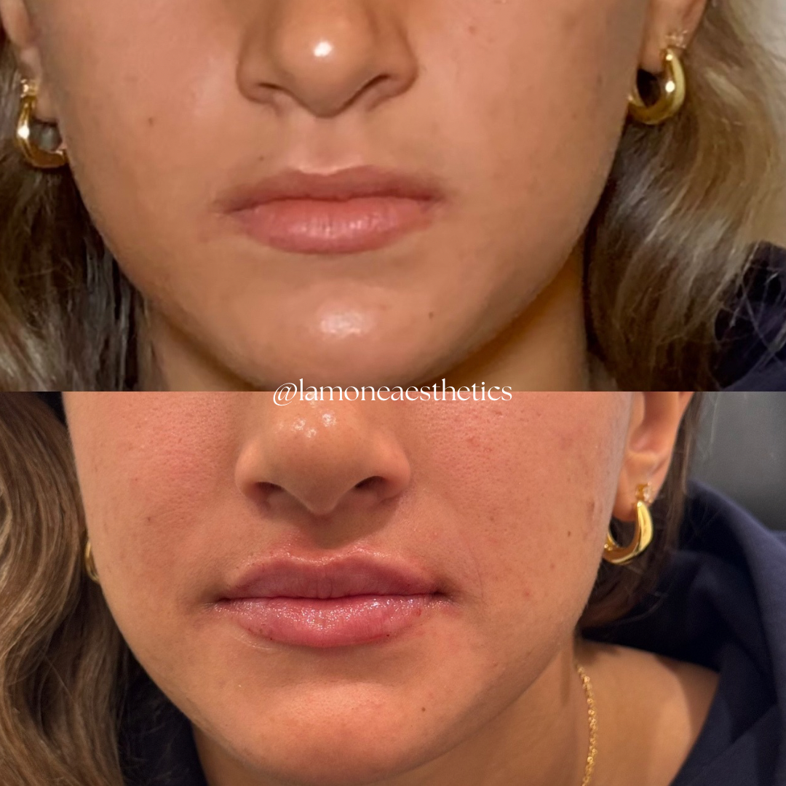

# Lip Filler Appointments in Bryn Mawr PA for First-Time Patients

Lip filler can add fullness, improve the outline of the lips, or adjust the balance between them. For a first treatment, the important distinction is the change you want—not simply whether you want more filler or less.

At La-Mon’e Aesthetics in Bryn Mawr, PA, [lip filler](https://www.lamoneaesthetics.com/lip-filler-bryn-mawr-pa/) is one of several injectable options. A first appointment involves assessing your lips and health history, planning the change, and allowing time for recovery before judging the result.

## What Can Lip Filler Change?

Hyaluronic acid filler adds volume where it is placed. Placement also affects the outline and proportions of the lips, so two treatments using similar amounts may pursue different goals.

Common goals include:

- **More fullness:** Increasing the volume of one or both lips.
- **A clearer outline:** Adding definition along parts of the lip border.
- **Better balance:** Addressing differences between the upper and lower lip or an uneven appearance.

These changes can overlap, but they need not all be part of your first treatment. Wanting a more defined upper lip, for example, does not necessarily mean wanting the lower lip enlarged as well.

La-Mon’e also offers a lip flip, which changes upper-lip movement through a muscle-relaxing injection. It does not add filler, so it addresses a different concern from wanting more volume in the lips at rest.

Your clinician determines which approach fits your anatomy and whether treatment is appropriate. You can arrive with a clear preference for the result without already knowing the product, amount, or injection pattern needed.

## What Does a La-Mon’e Treatment Example Show?

In this example from La-Mon’e's [lip gallery](https://www.lamoneaesthetics.com/gallery/), the upper lip appears fuller and its outline more defined. The change illustrates why fullness and definition are useful to consider together rather than treat size as the only measure of enhancement.

*Caption: Added fullness and upper-lip definition in a La-Mon’e lip-enhancement example. Individual results vary.*

The lower lip also appears fuller, changing the overall balance between the lips. Someone who likes the upper-lip definition but wants less overall volume may have a different treatment goal from the person pictured.

The photographs are an example of the practice's work, not a forecast of your result. Your starting shape matters, and the plan needs to suit your face rather than reproduce another person's lips.

## What Happens Before the Injections?

The assessment considers your lips in the context of your face, including their existing shape, proportions, and the areas you want changed. The proposed treatment should identify the product and amount as well as the intended result.

The assessment may include photographs of the areas being treated. These provide a starting record for comparing the change, particularly when an uneven outline or a difference between the lips is part of your concern.

Your health history is also relevant. Allergies, previous fillers, a history of cold sores, and current medicines can affect suitability or preparation.

This discussion can lead to a change in timing or a decision not to proceed. An active infection or inflammation near the treatment area, for example, may need to be managed before filler is injected.

La-Mon’e was founded by La-Tasha Walker, a registered nurse with a background in nursing and aesthetics. Dr. Glenn Rosen serves as medical director, giving the practice both an aesthetic nursing and medical oversight context.

Those roles do not determine who will perform your individual appointment. Confirm the treating clinician when booking, especially if you want to discuss a particular provider's approach.

## What Is the Treatment Itself Like?

The [American Society of Plastic Surgeons' procedure guidance](https://www.plasticsurgery.org/cosmetic-procedures/dermal-fillers/procedure) describes assessment, cleansing, comfort measures, injections, and evaluation of the result. The clinician may mark the areas being treated before starting.

Numbing cream or another anesthetic measure can reduce discomfort, but pressure or a pinch may still be noticeable. The treatment is not necessarily painless even when numbing is used.

An ice pack may be offered afterward to ease swelling or discomfort. Comfort measures help with the experience of treatment; they do not mean that bruising or tenderness cannot develop later.

Filler is placed at selected sites, with the change evaluated as the procedure progresses. The appointment includes more than the time spent injecting: assessment and aftercare instructions are part of the visit too.

Increased fullness can be visible immediately, but swelling contributes to that early appearance. Lips that look larger right after treatment are not necessarily the size they will be once recovery settles.

## When Can You Judge the Result?

La-Mon’e advises allowing a couple of weeks for the final appearance to emerge. This makes treatment immediately before a wedding, photographs, or another important event a poor way to leave room for recovery.

Early recovery can include swelling, bruising, tenderness, or redness. The amount of visible swelling varies, so another patient's quick recovery is not a reliable timetable for yours.

General recovery guidance includes avoiding intense physical activity for the first 24 to 48 hours to help limit swelling and bruising. Follow the instructions for your treatment, including any restrictions on activities or lip products.

Once swelling settles, you can better assess the fullness, outline, and balance. That is a different decision from reacting to the first mirror check after the injections.

An adjustment, if appropriate, is another treatment decision. The clinician needs to assess the settled result before deciding whether adding or reducing filler would address the concern.

## Which Reactions Need Prompt Attention?

Swelling and bruising are common, but they are not the only possible reactions. Lip filler carries medical risks even when the planned change is modest.

The [FDA's filler guidance](https://www.fda.gov/medical-devices/aesthetic-cosmetic-devices/dermal-fillers-soft-tissue-fillers) explains that rare injection into a blood vessel can block blood supply. Serious consequences can include tissue damage and vision loss.

Seek immediate medical attention for:

- Unusual pain during or shortly after treatment.
- Vision changes.
- White, gray, or blue skin near the injection site.

Those signs should not be treated as routine swelling to wait out. Before leaving the appointment, make sure you have the team's aftercare instructions and contact details for a concern.

## What Does the Price and Booking Commitment Include?

La-Mon’e's [injectable pricing](https://www.lamoneaesthetics.com/injectables-bryn-mawr-pa/) puts lip filler at $750 to $1,000. Confirm the current quote and what it covers before treatment.

Filler dissolving starts at $350 and may require multiple sessions, depending on the treatment needed. A correction can therefore involve additional visits and expense rather than being included automatically in the original price.

Removal has its own risks. The possibility of dissolving hyaluronic acid filler does not make an unwanted result or complication consequence-free.

Lip filler is temporary, so keeping a result may involve repeat treatment. La-Mon’e gives a six- to 18-month longevity estimate, with timing affected by the product and individual response.

The practice's [booking policies](https://www.lamoneaesthetics.com/about-us/) include a nonrefundable deposit. Extra guests and children cannot attend unless receiving a service; check the cancellation and rescheduling terms when reserving your visit.

These commitments belong alongside the cosmetic decision. The initial price, time for recovery, and possible future treatment all affect what a first appointment means for your plans.

## Arrange Your First Lip-Filler Consultation in Bryn Mawr

La-Mon’e's team can assess the change you want and discuss a suitable treatment plan. A first visit is an opportunity to connect that goal with your lips, health history, and recovery needs before deciding to proceed.

[Contact La-Mon’e Aesthetics in Bryn Mawr](https://www.lamoneaesthetics.com/contact/) or call 484-344-1261 to arrange a lip-filler consultation. Discuss the intended result and current treatment price when planning your appointment.
