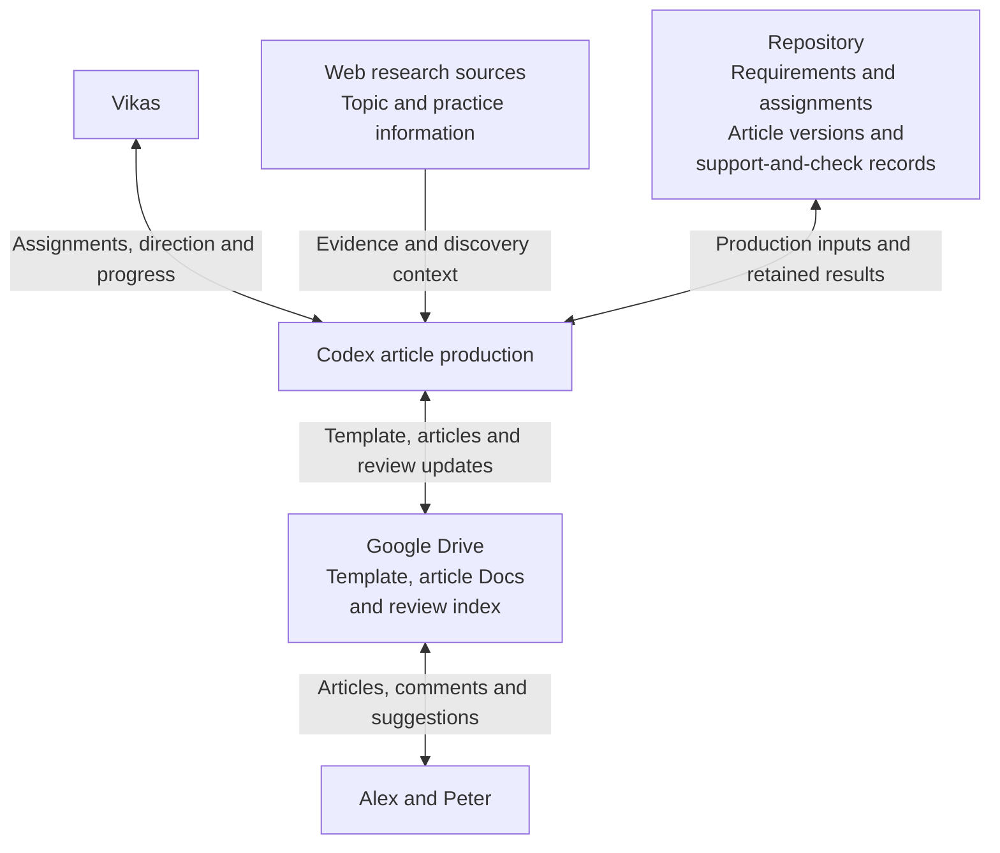

# Architecture

## System

Codex is the runtime for the current article production method. The diagram shows the people, inputs, retained records and review surfaces involved in an authorized production or revision task.

| Part | Responsibility |
|---|---|
| Codex article production | Carry out the research, drafting, evaluation, revision and delivery in [Article Production Flow](#article-production-flow), using the governing documents and available tools. |
| Repository | Supply governing requirements and original assignments; retain article versions and support-and-check records under [Data Model](data-model.md#assignments-and-article-status). |
| Web research sources | Supply evidence and discovery context for topic research and relevant practice context under [Research the Assigned Topic](#research-the-assigned-topic) and [Understand the Practice](#understand-the-practice). |
| Google Drive | Hold the reusable article Doc template, article Docs and ongoing review index under [User Design’s presentation](userdesign.md#article-content-and-writing-standards) and [delivery requirements](userdesign.md#assignment-delivery-and-tracking). |
| Vikas | Supply assignments and operator direction; receive progress and unresolved issues. |
| Alex and Peter | Review articles through comments and suggested edits. Alex is the contact for client information and confirms acceptance under [User Design](userdesign.md#review-revision-and-writing-feedback). |

Review information returns to the revision work in [Deliver to Alex](#deliver-to-alex). The production sections below define the research order, evaluation and correction flow, and delivery checks.

## Article Production Flow

Use the assignment to guide topic research, then develop the relevant practice context. Combine the findings and handle gaps under [Research and Resolve](#research-and-resolve) before outlining and drafting. Run the single evaluation and revision flow in [Evaluate and Revise](#evaluate-and-revise) before direct customer delivery under [User Design](userdesign.md#assignment-delivery-and-tracking).

Use the assignment brief, research notes, and outline as working context and adjust them as useful.

Later findings may change the working interpretation or require a return to topic or practice research. Production adjustments do not require separate compliance reviews at each stage.

### Understand the Assignment

Produce a structured working brief that gives research and writing a clear target.

Use the supplied client, prompt number, original title, SEO/AEO label, reference URLs, and special instructions in the working brief. Keep the supplied assignment distinct from its interpretation. Reference the original assignment in the support-and-check record rather than copy it into a separate permanent brief. Preserve the prompt number through revisions under [Data Model](data-model.md#assignments-and-article-status).

Infer an initial target reader and main question or decision from the supplied assignment. Choose one working interpretation, state it in the brief as a hypothesis with supporting evidence, and use it to guide research. Refine the interpretation and target reader as topic and practice evidence develops; do not maintain competing interpretations.

Identify claims implied by the title that need investigation, including superiority, permanence, pricing, availability, and clinician expertise. The title does not establish their truth. Keep missing inputs explicit when they affect the article's answer or an applicable requirement. The brief must establish the audience, purpose, and supplied constraints without silently replacing the assigned topic; resolve a proposed topic change with Alex.

### Research the Assigned Topic

Use the assignment brief to plan and carry out an article-specific investigation of the questions the article must answer and the claims it needs to support. The plan is working guidance and may change as research develops.

Choose research questions and sources that fit the assignment. Topic research may concern treatments, clinician expertise, a practice's approach, professional training, or an alleged advantage. It is not limited to general medical education. Use practice sources during topic research when the assigned question concerns the practice or a named clinician; the research sequence stays the same.

Use supplied reference URLs as starting points rather than material to rewrite or the only sources to consult. Consult authoritative third-party sources for general treatment facts and practice sources for the practice's own services and care under [Writing Standards' Medical Claims](writing-standards.md#medical-claims). Investigate the claims rather than assume that a reference or the assignment title establishes them.

Include a review of leading organic Google results for the same topic. Derive queries from the assignment and working interpretation, including geography when relevant. Examine reader questions, comparisons, considerations, answer structure, omissions, and weak explanations to inform a more useful original article. Search ranking does not establish medical accuracy, and competitor research does not permit competitor links in the delivered article under [Writing Standards](writing-standards.md#links).

Develop supported answers, practical expectations, and relevant distinctions for the assigned reader. Identify the practice questions needed to develop those answers, and use them to guide [Understand the Practice](#understand-the-practice). Keep supporting evidence and material limits under [Data Model](data-model.md#article-research-material). Findings remain open to revision as practice research develops. Identify questions that only Alex can resolve under [User Design](userdesign.md#review-revision-and-writing-feedback).

### Understand the Practice

Use the assignment brief and topic findings to establish the practice context that helps answer the reader's question. Focus the website review on relevant services, treatments, technology, clinicians, credentials, locations, practice approach, terminology, and differentiators under [Writing Standards](writing-standards.md#content-types). Develop useful practice context before outlining.

Use the site's navigation and sitemap, when available, to discover likely pages for each main treatment or service in the assignment. Read relevant pages and follow links to more specific or complementary information. Search the site for important practice questions that remain unanswered. Combine relevant facts across pages; a service page, product page, clinician biography, gallery, or policy page may each supply different parts of the answer. Build on practice evidence already found during topic research.

Examine relevant practice information using Writing Standards' material categories to guide the search. Find useful service, clinician, educational, contact, and booking links, and investigate relevant practice claims from the brief and topic findings.

Stop expanding the website review when the needed practice questions have supported answers and additional relevant pages mostly repeat information, or when targeted searches yield no further usable evidence. Carry remaining gaps and conflicting facts into [Research and Resolve](#research-and-resolve) before relying on them in the article. Later research or drafting may identify a specific question that requires another website visit.

Keep source evidence and limits needed to use the findings accurately under [Data Model](data-model.md#article-research-material). Preserve correct clinician associations and distinguish physical locations from article target geography and treatments from bookable appointments under [Client Information](data-model.md#client-information). Product-brand evidence does not establish every formulation or model.

Use the supported material available. This stage does not require material from every category or a general client model.

### Research and Resolve

Combine topic findings and practice context to establish a supported central answer. Confirm or revise the target reader and working interpretation using the combined evidence, and investigate conflicting information before outlining. Keep the evidence needed to support the article under [Data Model](data-model.md#article-research-material).

A missing fact is required when the article needs it to satisfy [Writing Standards](writing-standards.md), an applicable assignment requirement, or its central answer. Use supported wording or omit the detail when that satisfies the requirements without weakening the answer. Material that could improve an otherwise complete, compliant article is optional.

Handle the remaining gap according to its effect on this article:

- **Optional material:** Prepare the article without it and use [User Design's optional-material comments](userdesign.md#review-revision-and-writing-feedback).
- **A required answer that could change the direction:** Resolve it before drafting when it could change the premise, treatment focus, central answer, or recommendation. Investigate further or bring the specific question to Alex when only he can resolve it. Keep the dependency explicit; a marker does not establish a supported direction.
- **A required fact that can be inserted later:** When Alex can supply the fact without changing the supported direction, draft the supported content and use [User Design's Needs Information process](userdesign.md#review-revision-and-writing-feedback). Apply [Evaluate and Revise](#evaluate-and-revise) before delivery; missing information does not excuse other failures.

Base these decisions on the article's actual needs. Use the supported central answer, practice context, and explicit remaining dependencies to guide [Build the Outline](#build-the-outline).

### Build the Outline

Build the outline from the combined research findings and supported central answer. Arrange reader questions into a useful sequence and plan headings with substantive answers under [Writing Standards](writing-standards.md#section-focus). Integrate supported practice material where it develops those answers. Do not assign section word budgets.

Plan clinician selection under [Writing Standards](writing-standards.md#clinician-selection), useful internal links, appropriate external links, and the closing call to action. Place useful practice material where it supports an explanation, and identify locations for unresolved required facts and comments.

Adjust coverage or return to the relevant topic or practice research when the outline lacks a supported answer. Combine repetitive sections and omit material that does not support its heading. If research cannot support the assigned answer, bring the specific gap to the operator rather than invent material or silently change the topic. The outline guides drafting; customization is checked in [Evaluate and Revise](#evaluate-and-revise).

### Write the First Draft

Produce a complete article from the outline and supported research under [Writing Standards](writing-standards.md). Adjust the outline and material choices when that improves the article.

Use relevant supported practice material, links, and a customized call to action under [User Design](userdesign.md#article-content-and-writing-standards). If optional material cannot be used, choose another supported approach and keep the evidence needed for the resulting article.

Prepare markers and Google Doc comments for unresolved required facts and applicable optional-material requests under [User Design](userdesign.md#review-revision-and-writing-feedback). Preserve source support for factual claims, including claims introduced during writing.

Pass the completed article and supporting evidence to Evaluate and Revise. Drafting does not have its own compliance gate or checklist.

### Evaluate and Revise

Check the complete article against every applicable requirement in [Writing Standards](writing-standards.md), its assignment-specific instructions, and the presentation requirements in [User Design](userdesign.md#article-content-and-writing-standards). This is the single evaluation and revision flow before delivery. Run it as part of production without a manual trigger or Vikas's article-by-article approval.

Complete the initial evaluation before starting the focused correction pass. Use [Engineering](engineering.md#article-verification) to perform the full checklist applicable to the local article. Establish an outcome for each applicable check before repair begins. Assess quality before measuring body words under [Writing Standards](writing-standards.md#body-word-count). Give the correction pass the combined findings from this evaluation. Identify unavailable evidence and unperformed checks explicitly, and handle required facts awaiting Alex under the process below. Actual customer-Doc preservation is checked during delivery. Do not add checks or delivery dependencies for unresolved customer questions.

Identify each failed requirement, its location, and the correction needed. Use Engineering's check-specific repair criteria to decide whether affected content should be removed, rewritten, shortened, moved, combined, or supported through further research. Before recommending removal, check whether the deletion would lose a necessary answer, qualification, or connection in the explanation. Preserve useful meaning without keeping unnecessary wording. Develop missing or inadequately supported answers, returning to research or changing the outline when needed.

For the current method in Codex, make a focused correction pass that addresses the combined findings. Then repeat the full applicable local-article checklist on the resulting article, including factual support, readability, completeness, necessary qualifications, and flow after deletions. Measure the resulting body words after quality assessment and apply Writing Standards' length rule. Do not restore removed content or add replacement words solely to reach the drafting target. Retain the current assessment under [Data Model](data-model.md#assignments-and-article-status); the initial evaluation is working material rather than a separate permanent assessment. A separate automated repair engine or open-ended retry loop is not required. If failures remain after the correction pass, report them to the operator and keep the article incomplete pending further work. Do not mark the article ready on the basis of checks against an earlier version.

Handle required facts awaiting Alex's input through User Design's markers, comments, and Needs Information process. The checklist must distinguish these facts from passed requirements, other failures, optional requests, and requirements that do not apply. Missing information does not excuse other failures.

Proceed to delivery only when no failures remain, apart from required facts permitted through the Needs Information process. With required facts resolved, the article may be delivered as Ready for Review. Verification does not establish customer acceptance.

### Deliver to Alex

Deliver the evaluated article through the experience in [User Design’s Assignment Delivery and Tracking](userdesign.md#assignment-delivery-and-tracking).

Preserve the evaluated text, headings, links and markers in the assigned Google Doc. Add missing-information comments under [Review, Revision, and Writing Feedback](userdesign.md#review-revision-and-writing-feedback); plain-text notes do not replace Google Doc comments.

Verify that the actual customer Doc preserves the evaluated article and its required comments under [Engineering](engineering.md#customer-delivery-verification). A local export or successful upload alone does not establish delivery. Correct transfer or rendering failures. If delivery or correction changes the evaluated article’s content or presentation, use Evaluate and Revise to check the resulting version before claiming delivery complete.

Update the article’s entry in the review index under User Design and record its status in the support-and-check record under [Data Model](data-model.md#assignments-and-article-status). Use Needs Information for required facts awaiting Alex; otherwise use Ready for Review after the checks pass. Delivery is complete when the Doc, comments, entry in the review index and recorded status are correct.

When Alex provides information or feedback, revise the same Doc and use Evaluate and Revise before updating its status under User Design. Accepted requires Alex’s confirmation.
